<!--
  ╭──────────────────────────────────────────────────────────────╮
  │  README de perfil — Lucas Jesus                              │
  │  Paleta: fundo #FAFAF7 · texto #1C1C1A · destaque #0E7C66     │
  │  Para adicionar coisas, procure os comentários "➕ ADICIONAR" │
  ╰──────────────────────────────────────────────────────────────╯
-->

  

  
  
  
  
  

---

### Sobre

> **No momento** · conduzindo a fase final da migração de ERP (legado → Omie + IAPP) · estruturando a central de chamados da empresa.

---

### Stack

Separada pelo que eu uso no dia a dia e pelo que já usei em projetos. Sem barrinha de porcentagem — a prova está nos projetos abaixo.

**Uso diário**

**Já usei em projetos**

**Infra, ERP e operação**

**Domínio** · NF-e · SPED · NCM/CEST · LGPD · eSocial · ANVISA · ISO 9001 / 22716

<!-- ➕ ADICIONAR tecnologia: copie uma linha e troque NOME, LOGO e COR

     Lista de logos: https://simpleicons.org -->

---

### Experiência

**Analista de TI & Desenvolvedor de Sistemas** · GlobalPro Cosméticos · 20XX — atual
- TI completa de uma indústria multi-unidade: suporte N1–N3, rede, servidores, e-mail e desenvolvimento interno
- Liderança técnica da migração do ERP legado para **Omie + IAPP**: mapeamento de campos, saneamento de cadastro, NCM/CEST, treinamentos e homologação de NF-e
- Auditoria de *master data* em 5 bancos SQL Server que revelou milhares de conflitos e órfãos bloqueando a migração — e virou uma ferramenta de monitoramento contínuo
- Propostas de investimento para a diretoria (backup NAS, firewall/segmentação, suporte remoto) escritas em linguagem de negócio
- Padronização de atas de treinamento em modelo ISO (FORM-ATA-001), gerando FAQ e trilha de auditoria

**Freelancer** · Hardware e tecnologia · paralelo

<!-- ➕ ADICIONAR experiência:
**Cargo** · Empresa · início — fim
- O que você fez + qual foi o resultado -->

---

### Projetos

| | Projeto | O que resolve | Stack |
|:-:|---|---|---|
| 🔍 | **Visualizador GlobalPro** | Auditoria contínua de dados mestres com 9 abas de análise e *fuzzy matching* — nasceu de um dossiê para a diretoria antes da migração | Next.js · TS · SQL Server |
| 🔁 | **Migração ERP** | Legado → Omie + IAPP: saneamento de ~1,2 mil conflitos de código, mapeamento de campos e operação em paralelo para validação | SQL · Omie · IAPP |
| 🧾 | **Necessidade de Produção** | Transformar a planilha manual de necessidade de produção em aplicação web | Next.js · PostgreSQL |
| 🎫 | **Central de Chamados** | Fluxo de 6 etapas com SLA por prioridade (2h a 24h) e integração por e-mail em andamento | Pipefy · cPanel |
| 🌐 | **Rede corporativa** | Projeto dual-WAN (Starlink + fibra) com UniFi e cobertura por APs | UniFi · Starlink |

<b>Mais projetos</b>

 

| | Projeto | O que resolve | Stack |
|:-:|---|---|---|
| 🧩 | **Sistema interno unificado** | Substitui três planilhas operacionais por um sistema web único | Next.js · PostgreSQL |
| 📦 | **Acompanhamento de insumos** | Chegada, conferência de qualidade e comunicação com cliente por modalidade de pedido | Web |

<!-- ➕ ADICIONAR projeto (copie a linha):
| 🔧 | **Nome** | Problema que resolve | Stack | -->

---

### Como eu penso

Casos reais no formato <b>contexto → ação → conclusão</b>. É a parte que um currículo não mostra.

<table>
<tr>
<td width="50%" valign="top">

**📊 O relatório que duplicava vendas**

**Contexto** · um relatório de faturamento mostrava valores maiores que o real.
**Ação** · isolei as junções uma a uma até achar um *fan-out* no JOIN multiplicando linhas.
**Conclusão** · antes de confiar num número, conte as linhas de cada etapa. Agregue antes de juntar.

</td>
<td width="50%" valign="top">

**🗃️ Auditar antes de migrar**

**Contexto** · a migração de ERP parecia pronta para começar.
**Ação** · auditei os 5 bancos e levei os números para a diretoria em um dossiê.
**Conclusão** · migração não é cópia de dados, é decisão sobre eles. Dado sujo migrado continua sujo — só que em outro sistema.

</td>
</tr>
<tr>
<td width="50%" valign="top">

**🔀 Rodar em paralelo**

**Contexto** · o estoque do legado aceitava saldo negativo e o novo sistema não recomendava isso.
**Ação** · em vez de virar a chave de uma vez, mantive os dois rodando e validei com o fornecedor.
**Conclusão** · quando a regra do sistema novo contradiz a operação, entenda o *porquê* da operação antes de forçar qualquer lado.

</td>
<td width="50%" valign="top">

**💬 Falar a língua de quem decide**

**Contexto** · infraestrutura precisava de investimento (backup, firewall, suporte remoto).
**Ação** · escrevi propostas com risco, custo e cenário de falha — não com especificação técnica.
**Conclusão** · diretoria não compra tecnologia, compra redução de risco. Traduzir é metade do trabalho.

</td>
</tr>
</table>

<!-- ➕ ADICIONAR reflexão: copie um bloco <td> ... </td> (abra um novo <tr> a cada 2) -->

---

### Certificados

<!-- ➕ ADICIONAR certificado: copie uma linha da tabela.
     Link: Credly, Microsoft Learn, Alura, Udemy ou um PDF salvo em /certificados neste repositório. -->

| Certificado | Emissor | Data | |
|---|---|:-:|:-:|
| **Ask Questions to Make Data-Driven Decisions**  Google Data Analytics · nota 91,9% | Google · Coursera | out/2026 | [verificar ↗](https://www.coursera.org/account/accomplishments/verify/6H9OZ5ZW28Z9) |
| **Foundations: Data, Data, Everywhere**  Google Data Analytics · nota 88,3% | Google · Coursera | out/2026 | [verificar ↗](https://www.coursera.org/account/accomplishments/verify/BL99VOE0TS7R) |
| **IBM Garage Essentials**  Agile · Design Thinking · IBM Garage Methodology | IBM · Credly | ago/2026 | [verificar ↗](https://www.credly.com/badges/06a92c19-fec9-4d7f-be6e-81190c6db206/public_url) |
| **Curso de Python 3 do básico ao avançado**  141h · POO, Django, PySide6, SQL, TDD, Design Patterns GoF | Udemy | jun/2025 | [verificar ↗](https://ude.my/UC-adbf7bf9-e91c-47ea-a348-462869648b5c) |

<b>Cursos concluídos e em andamento</b>

 

- [x] **Git e GitHub para iniciantes** — Udemy · Willian Justen · [curso ↗](https://www.udemy.com/course/git-e-github-para-iniciantes/)
- [ ] **Google Data Analytics** (certificado profissional) — Coursera · em andamento

---

### No GitHub

  
  

  

  <picture>
    <source media="(prefers-color-scheme: dark)" srcset="https://raw.githubusercontent.com/lucasjpl1/lucasjpl1/output/github-contribution-grid-snake-dark.svg">
    
  </picture>

---

  Processo manual vira sistema. Sistema vira dado. Dado vira decisão. 
  

